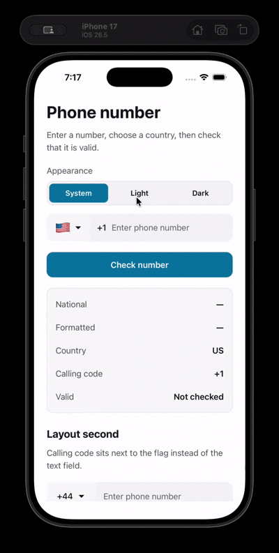

# react-native-phone-number-input

[](https://www.npmjs.com/package/react-native-phone-number-input)
[](https://www.npmjs.com/package/react-native-phone-number-input)
[](./LICENSE.md)
[](#requirements)

An international phone number input for React Native, with a built-in country picker and validation powered by Google's libphonenumber.

This is a maintained continuation of the original `react-native-phone-number-input`, updated for React 19, React Native 0.78+ and the New Architecture.

## Demo

<p align="center">
  
</p>

---

## Table of contents

- [Demo](#demo)
- [Highlights](#highlights)
- [Requirements](#requirements)
- [Installation](#installation)
- [Quick start](#quick-start)
- [Layouts](#layouts)
- [Dark theme](#dark-theme)
- [API reference](#api-reference)
  - [Props](#props)
  - [Instance methods](#instance-methods)
  - [Named exports](#named-exports)
- [Migrating from 2.x](#migrating-from-2x)
- [Example app](#example-app)
- [Troubleshooting](#troubleshooting)
- [Contributing](#contributing)
- [License](#license)

---

## Highlights

- **Cross-platform** — one component for iOS and Android.
- **Country picker included** — searchable modal from [`react-native-country-picker-modal`](https://github.com/xcarpentier/react-native-country-picker-modal), with flags, emoji and calling codes.
- **Real validation** — national and international numbers validated with [`google-libphonenumber`](https://github.com/google/libphonenumber).
- **Fully styleable** — every container, the flag button, the text input and the calling-code label accept your own styles.
- **Light and dark themes** — a single `withDarkTheme` prop themes the input and the picker modal.
- **Typed** — ships TypeScript definitions, including typed country-picker options.

## Requirements

| Peer dependency | Supported version |
| --------------- | ----------------- |
| `react`         | `>= 19.0.0`       |
| `react-native`  | `>= 0.78.0`       |

`google-libphonenumber` and `react-native-country-picker-modal` are regular dependencies of this package — you do not need to install them separately.

Verified on the New Architecture (Fabric); the bundled example app runs on Expo SDK 57 / React Native 0.86.

## Installation

```bash
yarn add react-native-phone-number-input
```

```bash
npm install react-native-phone-number-input
```

No native linking or extra configuration is required.

## Quick start

```tsx
import React, { useRef, useState } from "react";
import { SafeAreaView, StyleSheet, Text, TouchableOpacity, View } from "react-native";
import PhoneInput from "react-native-phone-number-input";

const App = () => {
  const phoneInput = useRef<PhoneInput>(null);
  const [value, setValue] = useState("");
  const [formattedValue, setFormattedValue] = useState("");
  const [valid, setValid] = useState<boolean | null>(null);

  const handleCheck = () => {
    setValid(phoneInput.current?.isValidNumber(value) ?? false);
  };

  return (
    <SafeAreaView style={styles.container}>
      <PhoneInput
        ref={phoneInput}
        defaultCode="US"
        layout="first"
        placeholder="Enter phone number"
        defaultValue={value}
        onChangeText={(text) => {
          setValue(text);
          setValid(null);
        }}
        onChangeFormattedText={setFormattedValue}
        onChangeCountry={(country) => console.log(country.cca2)}
        withShadow
        autoFocus
      />

      <TouchableOpacity style={styles.button} onPress={handleCheck}>
        <Text style={styles.buttonText}>Check number</Text>
      </TouchableOpacity>

      <View>
        <Text>National: {value}</Text>
        <Text>Formatted: {formattedValue}</Text>
        <Text>Valid: {valid === null ? "not checked" : String(valid)}</Text>
      </View>
    </SafeAreaView>
  );
};

const styles = StyleSheet.create({
  container: { flex: 1, padding: 24, gap: 16 },
  button: {
    height: 48,
    borderRadius: 12,
    alignItems: "center",
    justifyContent: "center",
    backgroundColor: "#0a7ea4",
  },
  buttonText: { color: "#fff", fontWeight: "600" },
});

export default App;
```

`onChangeText` reports the national number as typed. `onChangeFormattedText` reports the full international number (`+1` + national number), which is normally what you persist.

## Layouts

| `layout`   | Result                                                      |
| ---------- | ----------------------------------------------------------- |
| `"first"`  | Flag button, then the calling code inside the input area.    |
| `"second"` | Flag button and calling code grouped together, then the input. |

```tsx
<PhoneInput defaultCode="GB" layout="second" />
```

See the [demo](#demo) above for the component in action.

## Dark theme

`withDarkTheme` switches the component and the country picker modal to the dark palette and sets the keyboard appearance accordingly.

```tsx
const isDark = useColorScheme() === "dark";

<PhoneInput
  defaultCode="US"
  withDarkTheme={isDark}
  withShadow={!isDark}
  textInputStyle={{ color: isDark ? "#ECEDEE" : "#11181C" }}
/>;
```

## API reference

### Props

**Value and country**

| Prop           | Type          | Default | Description                                                     |
| -------------- | ------------- | ------- | --------------------------------------------------------------- |
| `defaultCode`  | `CountryCode` | `"IN"`  | Country selected on mount, e.g. `"US"`. Its calling code is resolved automatically. |
| `defaultValue` | `string`      | `""`    | Initial national number (uncontrolled).                          |
| `value`        | `string`      | —       | National number to seed the input with. The component keeps its own state as the user types, so a later `value` change is only picked up when `disabled` changes too — for fully controlled usage, drive the input with `onChangeText` state. |
| `disabled`     | `boolean`     | `false` | Makes the input read-only and blocks the country picker.         |

**Callbacks**

| Prop                    | Type                          | Description                                                    |
| ----------------------- | ----------------------------- | -------------------------------------------------------------- |
| `onChangeText`          | `(text: string) => void`      | Fired with the national number as the user types.               |
| `onChangeFormattedText` | `(text: string) => void`      | Fired with the full international number (`+<code><number>`).   |
| `onChangeCountry`       | `(country: Country) => void`  | Fired when a country is picked; receives the full country object. |

**Appearance**

| Prop                       | Type                     | Default   | Description                                             |
| -------------------------- | ------------------------ | --------- | ------------------------------------------------------- |
| `layout`                   | `"first" \| "second"`    | `"first"` | Position of the calling code — see [Layouts](#layouts). |
| `withDarkTheme`            | `boolean`                | `false`   | Dark palette for the input and the picker modal.        |
| `withShadow`               | `boolean`                | `false`   | Drop shadow around the container.                       |
| `autoFocus`                | `boolean`                | `false`   | Focus the text input on mount.                          |
| `placeholder`              | `string`                 | `"Phone Number"` | Text input placeholder.                          |
| `disableArrowIcon`         | `boolean`                | `false`   | Hide the dropdown arrow.                                |
| `renderDropdownImage`      | `JSX.Element`            | —         | Custom dropdown arrow element.                          |
| `containerStyle`           | `StyleProp<ViewStyle>`   | —         | Outer container.                                        |
| `textContainerStyle`       | `StyleProp<ViewStyle>`   | —         | Container around the calling code and text input.       |
| `textInputStyle`           | `StyleProp<TextStyle>`   | —         | The text input itself.                                  |
| `codeTextStyle`            | `StyleProp<TextStyle>`   | —         | The `+1` calling-code label.                            |
| `flagButtonStyle`          | `StyleProp<ViewStyle>`   | —         | The flag / country button.                              |
| `flagSize`                 | `number`                 | theme default | Size of the flag in `layout="first"`. Available at runtime; not yet in the TypeScript definitions. |
| `countryPickerButtonStyle` | `StyleProp<ViewStyle>`   | —         | Additional styles merged onto the flag button.          |

**Escape hatches**

| Prop                 | Type                              | Description                                                                 |
| -------------------- | --------------------------------- | --------------------------------------------------------------------------- |
| `textInputProps`     | [`TextInputProps`](https://reactnative.dev/docs/textinput) | Spread onto the underlying `TextInput`, overriding the defaults (`keyboardType="number-pad"`, `selectionColor="black"`) — e.g. `placeholderTextColor`, `maxLength`. |
| `filterProps`        | `CountryFilterProps`              | Props for the country search field.                                         |
| `countryPickerProps` | `Partial<CountryPickerModalProps>` | Props forwarded to the country picker modal.                               |

### Instance methods

Available through a `ref` to the component.

| Method                                  | Signature                                              | Description                                                                                 |
| --------------------------------------- | ------------------------------------------------------ | ------------------------------------------------------------------------------------------- |
| `isValidNumber`                         | `(number: string) => boolean`                          | Validates a national number against the selected country.                                    |
| `getCountryCode`                        | `() => CountryCode`                                    | ISO country code currently selected, e.g. `"US"`.                                             |
| `getCallingCode`                        | `() => string \| undefined`                            | Calling code currently selected, e.g. `"1"`.                                                  |
| `getNumberAfterPossiblyEliminatingZero` | `() => { number: string; formattedNumber: string }`    | Returns the number with a leading `0` stripped, plus its international form.                  |
| `setPhoneNumber`                        | `(phoneNumberWithCode: string) => void`                | Parses a full international number (e.g. `"+14155552671"`), selects the matching country and fills the input. Available at runtime; not yet in the TypeScript definitions. |

```tsx
const phoneInput = useRef<PhoneInput>(null);

phoneInput.current?.isValidNumber("4155552671"); // true
phoneInput.current?.getCallingCode(); // "1"
```

### Named exports

```tsx
import PhoneInput, {
  isValidNumber,
  CountryPicker,
  getCallingCode,
  DARK_THEME,
  DEFAULT_THEME,
  Flag,
} from "react-native-phone-number-input";

isValidNumber("4155552671", "US"); // true — standalone, no ref required
```

`CountryPicker`, `getCallingCode`, `DARK_THEME`, `DEFAULT_THEME` and `Flag` are re-exported from `react-native-country-picker-modal`.

## Migrating from 2.x

Version 3.0.0 modernises the package for React 19 and React Native 0.78+.

| Change                                                                              | Action required                                                       |
| ----------------------------------------------------------------------------------- | --------------------------------------------------------------------- |
| React 19 and React Native 0.78+ are now the minimum supported versions.             | Upgrade your app before installing 3.x.                               |
| `CountryModalProvider` is no longer used internally and is no longer exported.       | Remove it from your component tree — the modal works without it.      |
| `react-native-safe-area-context` is no longer a peer dependency.                    | Uninstall it if you added it only for this package.                   |
| Depends on upstream `react-native-country-picker-modal@^3.0.0` (the `@effektsvk` fork is gone). | Remove any resolution or override pinning the fork.        |
| `countryPickerProps` is typed as `Partial<CountryPickerModalProps>` instead of `any`. | Fix any props that were not valid picker props.                      |
| `disabled` now blocks touches on the flag button and keeps the modal closed.         | None — behaviour fix.                                                 |

## Example app

The `example/` folder contains an Expo Router app that consumes the library straight from the repository root.

```bash
cd example
yarn install
yarn ios      # or: yarn android
```

It demonstrates both layouts, light/dark theming, country selection and validation. Source: [`example/app/index.tsx`](./example/app/index.tsx).

## Troubleshooting

**Is it supported and tested on both Android and iOS?**
Yes, and on the New Architecture.

**The country modal does not open.** Check that `disabled` is not set — a disabled input intentionally ignores taps on the flag button.

**Peer dependency warnings on install.** Version 3.x requires React 19 and React Native 0.78 or newer. Stay on 2.x if you cannot upgrade yet.

**Validation returns `false` for a number that looks right.** `isValidNumber` validates against the currently selected country. Select the correct country first, or use the standalone `isValidNumber(number, countryCode)` export.

## Contributing

Contributions are welcome.

1. Fork the repository and clone it locally.
2. Make your change in `lib/`, keeping `lib/index.d.ts` in sync with `lib/index.js`.
3. Verify it in the example app (`cd example && yarn install && yarn ios`).
4. Open a pull request against [`bilal1031/react-native-phone-number-input`](https://github.com/bilal1031/react-native-phone-number-input).

Bug reports and feature requests belong in [GitHub Issues](https://github.com/bilal1031/react-native-phone-number-input/issues).

## License

[MIT](./LICENSE.md)
